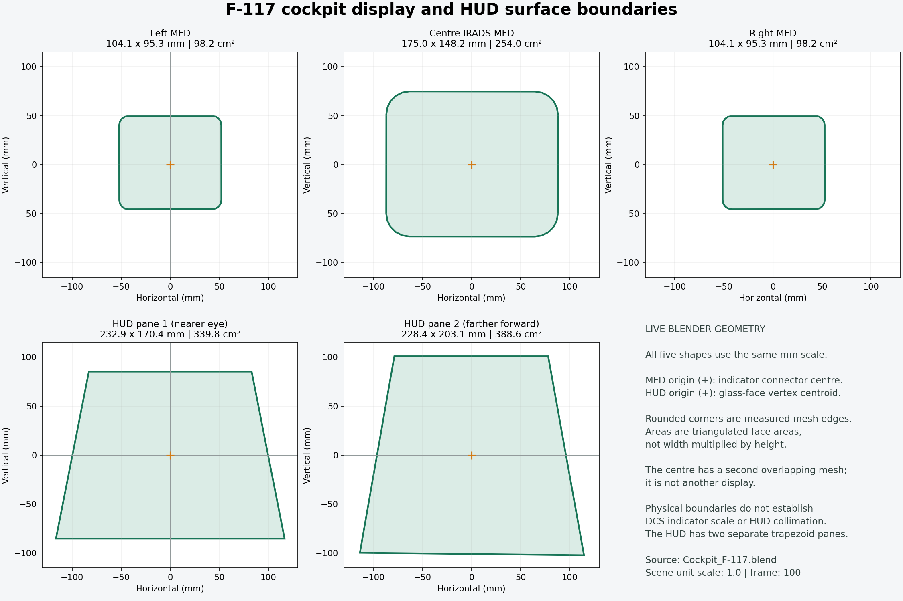

# Cockpit display measurements

Measured through the live Blender MCP connection from `blender_files/Cockpit_F-117.blend`,
at frame 100 with scene unit scale 1.0. The measurement script reads evaluated
world-space vertices and triangulated face areas. It does not alter or save the scene.

| Surface | Width x height envelope (mm) | Face area (cm²) | Mesh |
| --- | --- | --- | --- |
| Left MFD | 104.10 x 95.25 | 98.20 | `Cockpit.007`, left screen component |
| Centre MFD | 175.02 x 148.18 | 254.00 | `Cockpit.043` |
| Right MFD | 104.10 x 95.25 | 98.20 | `Cockpit.007`, right screen component |
| HUD pane 1, nearer eye | 232.93 x 170.43 | 339.84 | `Cockpit glass.001`, near broad face |
| HUD pane 2, farther forward | 228.37 x 203.07 | 388.62 | `Cockpit glass.001`, far broad face |

MFD width/height are bounding envelopes in each connector coordinate frame.
Glass width/height are envelopes in a fitted local plane. Faces are rounded or
trapezoidal, so their areas are smaller than width multiplied by height.
MFD planarity residuals are below 0.001 mm; the far HUD pane residual is about
0.014 mm. These values describe the model mesh precision, not manufacturing tolerances.

The centre also has a parallel, overlapping mesh `Cockpit.044`, approximately
174.92 x 148.05 mm and 254.00 cm². It is recorded as a secondary surface and
is not counted as another display. The HUD's thin front/back faces and narrow
edge strips are likewise not counted as additional panes.

## MFD local boundaries

Coordinates below are millimetres relative to each connector centre. Positive X
points toward its RIGHT connector; positive Y points opposite its DOWN connector.
The full JSON records the rounded polygon, its world vertices and all three anchors.

| Display | X min | X max | Y min | Y max |
| --- | ---: | ---: | ---: | ---: |
| Centre | -87.00 | 88.02 | -73.45 | 74.73 |
| Left | -52.05 | 52.05 | -45.54 | 49.72 |
| Right | -51.30 | 52.80 | -45.54 | 49.72 |

The connector triples confirmed in this loaded blend are:

- Centre: `MFD-PLASHKA-CENTER`, `MFD-PLASHKA-DOWN`, `MFD-PLASHKA-RIGHT`.
- Left: `MFD-PLASHKA-CENTER1`, `MFD-PLASHKA-DOWN1`, `MFD-PLASHKA-RIGHT1`.
- Right: `RADAR-PLASHKA-CENTER`, `RADAR-PLASHKA-DOWN`, `RADAR-PLASHKA-RIGHT`.

Connector spans differ slightly from mesh edges. For example, the centre connector
width/height spans are about 175.34 x 144.98 mm, while the screen envelope is
175.02 x 148.18 mm. Each side connector span is about 107.38 x 90.52 mm, while
its screen is 104.10 x 95.25 mm. The editor uses the measured mesh polygons rather
than treating connector distances as exact screen edges.

## Using the boundaries in Layout Studio

Reopen the editor and enable **Measured MFD boundary (amber)**. The amber polygon
shows the physical screen footprint relative to its connector origin. Outside
regions are dimmed; they remain selectable so existing symbols can be moved inward.
The original side starter marks intentionally remain at their previous source
positions, making their oversize design area visible against the measured boundary.

**Guide units / metre** explicitly controls the conversion from physical metres
to the Lua layout coordinates. Its initial value is 1. This is a provisional
mapping, not a verified DCS scale. Adjust it against an in-game alignment reference
before treating the amber line as a validated pixel/clip boundary.

**View measured glass / screen shapes** opens the dimension diagram. HUD glass is
shown there instead of overlaid on its `SetScale(FOV)` layout: that layout uses
angular/collimated coordinates. Physical glass measurements alone do not define
its projected boundary. Eye position, indicator anchor/offset, projection and
the exported cockpit model must be checked in DCS. An in-game aperture can also
be reduced by surrounding bezel geometry.

## Reproducing the report

With the cockpit blend loaded, run `tools/measure_cockpit_displays.py` inside
Blender. It writes `tools/data/cockpit_display_geometry.json`. From the mod folder,
run `python tools/plot_cockpit_displays.py` to regenerate the diagram (requires
Matplotlib). The editor only needs the exported JSON, PNG and its normal dependencies.
