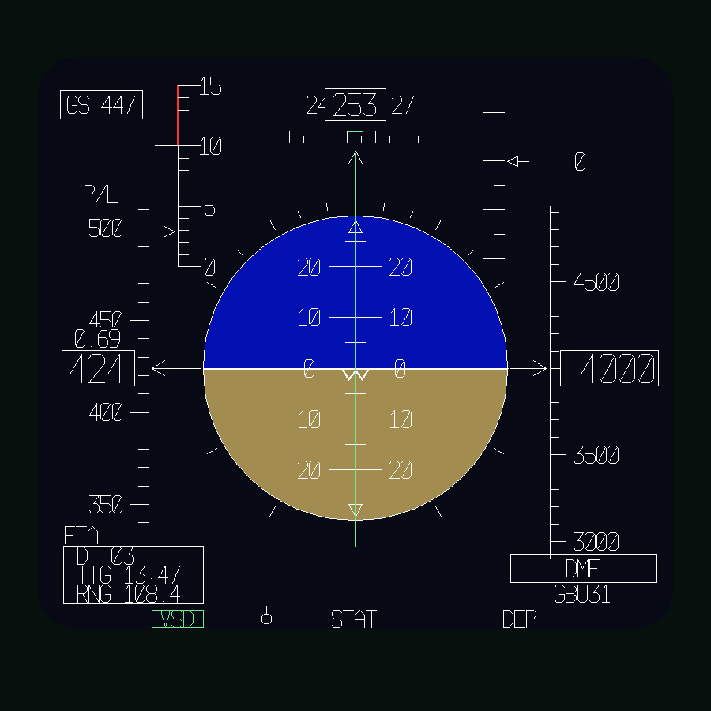

# Left MFD: colour VSD design

The editable **Left MFD** page in Layout Studio is now a basic vertical situation
display, drawn from PDF page 33 (printed 4-20), Figure 4-13, **Basic Display**.
The supplied Figure 4-2 illustration gives the same overall instrument arrangement;
the supplied cockpit photograph establishes the blue/brown presentation.

The final colour choices are Fraser's values: sky **#0310B2**, ground **#A38C50**.
Pale white markings sit over a dark navy background. Muted violet is used for the
VSD selection and a flight-director design cue; that accent is an interpretation
of the photograph, not a colour specification from the monochrome manual.

The page fits the previously measured left aperture of approximately
104.1 x 95.3 mm. It has an inset rounded drawing region, a circular attitude ball,
bank marks and fixed aircraft symbol; heading/AOA/VVI across the upper region;
airspeed and altitude at the sides; and the basic VSD status/data strip below.
The 5 degree pitch ladder increments are a preview mapping, not a calibrated
implementation of the aircraft's attitude display projection.

## Preview and edit

Launch `tools/cockpit/launch_layout_editor.bat`, choose **Left MFD**, and reset the view.
The source pane edits `Cockpit/Scripts/MFD/Indicator/Left/Left_vsd_page.lua`.
The colour palette and font sizes are in the adjacent `Left_display_def.lua`.
The old `Left_indication_page.lua` alignment starter is preserved separately.

The attitude ball uses `PITCH_HUD` and `ROLL_HUD` (radians); heading, CAS, GS,
Mach and altitude use existing HUD parameters in game and in the offline preview.
Altitude follows the existing HUD altitude-mode parameter.

Layout and symbol shapes follow the cockpit video frames in
`docs/reference/CockpitImages/CMDI_VSD`:

- Airspeed, altitude and heading tapes scroll with `CURR_IAS`, `ALTITUDE_HUD` and
  `HEADING_HUD`, each clipped to its own window and masked behind its readout box.
- AOA pointer follows `F117_OCIP_AOA` (0-15, red band above 10, index at 10).
- Ladder: continuous 10 degree bars numbered at both ends, `0` at the horizon,
  short 5 degree dashes. Bank marks go all round the ball; open triangles roll with it.
- Open chevrons tie the horizon to both tapes. `VSD` option is green.
- Store legend under DME comes from `F117_VSD_STORE`, set by `Systems/Weapons.lua`.
  After a release the fired store stays listed and is crossed out with thin red lines
  (`F117_VSD_STORE_FIRED`). It clears when the pilot steps station or a new release
  cue starts (fresh designation); then the next selected store is listed.
- CCRP release window staple: a green bracket on the steering line. It appears
  30 s before the ballistic release point (`F117_RELEASE_CUE_TTG`) and descends
  0.5 mm/s toward the pitch reference symbol. While the EFM reports the store in its
  release zone (`F117_RELEASE_CUE_IN_ZONE`) it sits on the symbol: release gate open.
  The cockpit video shows this with the DR box (INS inoperative or DR mode). The mod
  does not model INS modes yet, so the staple shows whenever a release cue is valid.
- `MEA` (boxed, above heading) and amber `DR` are gated on `F117_VSD_MEA` and
  `F117_NAV_DR`. Nothing sets those yet, so they stay blank in game.

- Destination (`D`), `TTG` and `RNG` in the boxed readout come from the mission route
  (`Systems/Navigation.lua`) and show dashes without one. `DME` is a bare legend:
  there is no TACAN receiver.

Still reference artwork, **not valid navigation, guidance or advisory indications**:
the green steering line and heading bug (always centred) and the VVI pointer
position. The `C <alt>` and `HC` command lines from the
video are not drawn because there is no altitude or heading command data yet.

**Registered as the default in-game left display** through `Left_init.lua` and
`device_init.lua`, on the calibrated `CMDI-L-CENTER / DOWN / RIGHT`
connector frame. Reload the aircraft/mission to load it. The left calibration
overlay is disabled in `Calibration/config.lua`; the HUD and centre
calibration overlays remain enabled. The right HSD is now registered too. Disabling calibration globally
leaves the VSD active.

No OSB actions, ILS modes, navigation calculations or
operational warning logic have been added. See [the right HSD notes](right-hsd-design.md) for the companion display.

Reference PNGs use approximate desktop font metrics; confirm physical font sizes
and line widths in game after reloading the aircraft. Depth testing
is enabled on the design primitives so cockpit objects can occlude them.

Validation: Lua execution, colour values, changing flight readouts, attitude
controller support, main-power gating, source dragging and visual PNG review.
