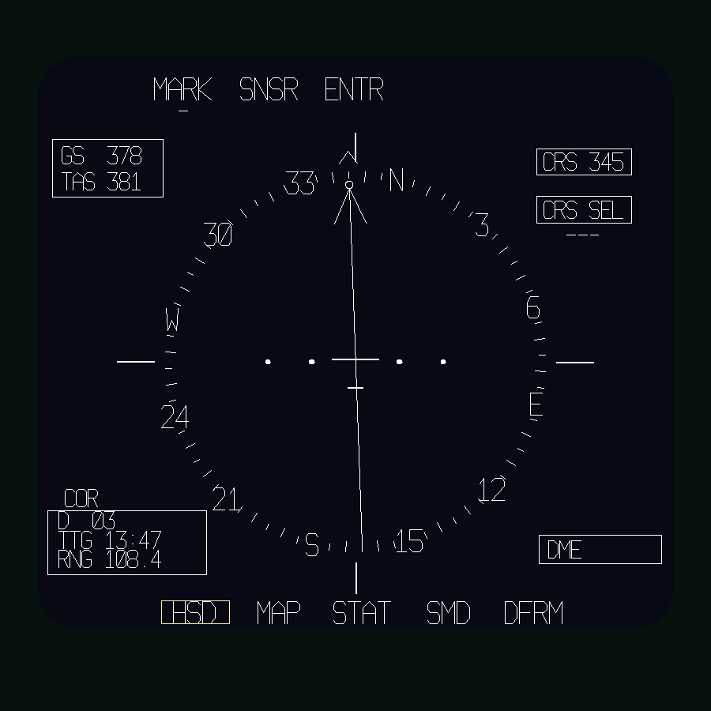

# Right MFD: basic HSD

Based on PDF page 36, printed 4-23, Figure 4-14, Basic HSD, with layout and
symbol shapes matched to the cockpit video frame in
`docs/reference/CockpitImages/CMDI_HSD`. Monochrome white on dark navy.

The heading-up card has five-degree graduations (ten-degree marks longer).
Labels (N, 3, 6, E, 12 ...) sit on the ring in place of the thirty-degree
graduations and stay upright as the card turns. A fixed lubber sits above the
ring, with wing reference marks outside it at 3 and 9 o'clock. Heading, GS and
TAS use `HEADING_HUD`, `GS_HUD` and `F117_OCIP_TAS` (knots, from
`HUD/Device/OCIP_data.lua`). The card rotates with heading; it does not move
with pitch or bank.

A shorter reference mark sits below the ring at 6 o'clock, clear of the STAT legend.

The course arrow (with its tip circle), the course line and a small arrowhead
outside the ring turn together to the desired course to the active waypoint
(`F117_NAV_REL_COURSE`, from `Systems/Navigation.lua`; see
[ocip-cockpit-research.md](../systems/ocip-cockpit-research.md#mission-route)). The desired
course is the planned leg into the active waypoint, or the direct bearing on the
first leg. Without a mission route they point up at the lubber. `CRS`, destination
(`D`), `TTG` and `RNG` come from the same source and show dashes without a route;
`CRS` follows the card reference (true or magnetic). The four deviation dots are
fixed: no deviation bar is drawn yet. CRS SEL, mark number and DME stay dashes or
blank, because those sources have not been connected. The double-box symbol on the ring in the video
frame is not drawn until identified. Switch legends are visual; OSB actions and
navigation calculations are not added by this page.

Registered as the default right display in `device_init.lua`, through
`MFD/Indicator/Right/Right_init.lua`, using the calibrated
`CMDI-R-CENTER / DOWN / RIGHT` connector frame. Right calibration is
disabled in `Calibration/config.lua` to prevent overlap. The historical RADAR
anchor name identifies the screen location. Depth testing is enabled, and the
rounded safe area fits the measured 104.1 x 95.3 mm aperture.

Reload the aircraft/mission to load the page. Use Layout Studio -> Right MFD to
edit `Right_hsd_page.lua`. Palette and fonts are in `Right_display_def.lua`.
The old `Right_indication_page.lua` alignment starter is preserved separately.
The amber outline in the preview is an editor guide and is not drawn in DCS.

Offline checks cover independent init/page environments, Lua syntax, registration
with calibration enabled/disabled, depth flags, power gating, card orientation at
four cardinal headings, changing GS, source editing and PNG review. DCS font
metrics and physical rendering still require in-game verification.
