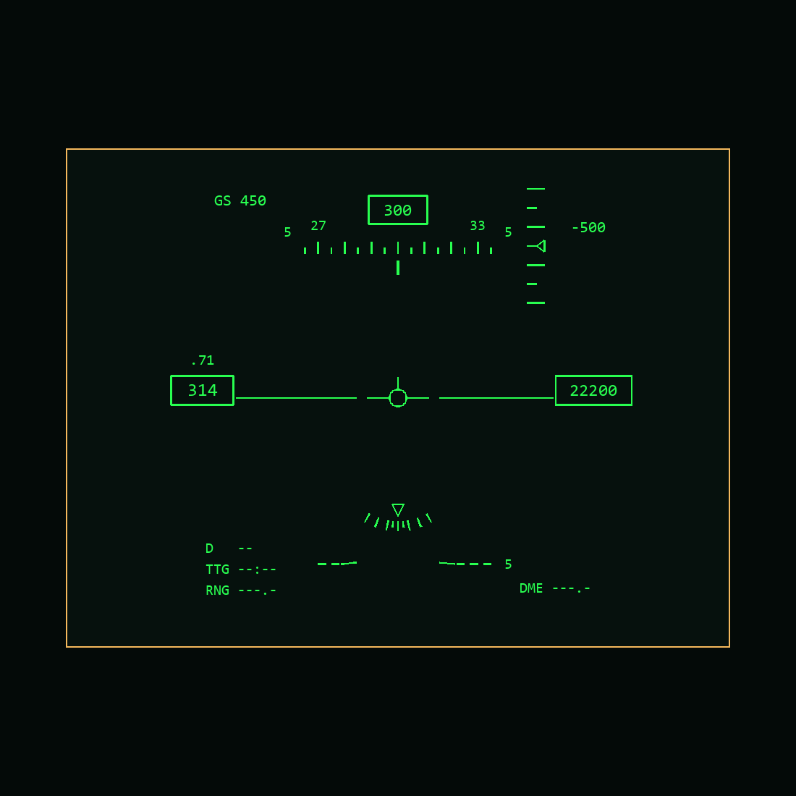

# Basic OCIP HUD

The active HUD now follows PDF page 21 (printed 4-8), Figure 4-4, and the detailed
text on the following page (printed 4-9). Numbered annotations, leader lines and
the illustration's circular outline are not HUD symbols and are not drawn.

The illustration above predates the attitude-reference correction below. The
current ladder preview follows the pitch parameter using projected angles. The amber rectangle is the
editor guide, not in-game symbology. Groundspeed and some readouts are illustrative
preview values. The real page reads simulation parameters.

## Active elements

- GS at upper left; boxed magnetic heading and moving heading scale at top.
  Ten-degree major ticks, odd five-degree minor ticks, labels at thirty degrees.
- Upper-right vertical-speed scale and moving pointer, with digital fpm readout.
- Boxed three-digit indicated/calibrated speed, Mach above, and boxed five-digit
  barometric altitude. Speed uses actual indicated airspeed below 50 knots rather
  than substituting GS as the previous HUD did.
- Procedural horizon and five-degree pitch bars, with centre gaps, negative-pitch
  dashes and bent inner ends toward the horizon. Conformal cues reference the
  optical axis independently of the fitted readout-layout centre. The manual's
  4.5-degree datum above display centre is a screen arrangement, not an extra
  aircraft pitch angle to add to sensor attitude.
- Flight-path marker, fixed W fallback for the explicit INS-valid parameter,
  approach AOA bracket and lower bank scale with moving triangle.
- Navigation and DME fields show unavailable values. Destination box, offset
  diamond and IRADS cross have explicit validity/angle contracts and are hidden
  until a real source supplies their new `F117_OCIP_*` parameters.

Readout data is supplied by `HUD/Device/OCIP_data.lua`, called by the existing
HUD device. Altitude is rounded to ten feet, or one hundred feet above 40 ft/s
vertical speed; airspeed to one knot, or five knots above 300 knots/s speed change.
The approach bracket enters below 200 knots, leaves above 230 and uses the current
12-degree optimum; one degree high AOA aligns its top arm with the flight-path
marker, as specified in the manual. The 12-degree optimum still needs validation
against the aircraft approach configuration.

The old oversized source is preserved as `HUD_previous_indication_page.lua`.
Existing VSD/HSD parameter bindings and their behaviour are unchanged.

## Calibration and limitations

`HUD_indication_page.lua` uses milliradian drawing coordinates converted to the
existing FOV source units using DCS `GetScale()`. Layout Studio reproduces that
ratio from the engine log; the first captured values were FOV 0.085879072547 and
mrad 0.000600000028498. No mesh-to-angle estimate is substituted.

The accepted 20 x 15 degree design area, origin `{0,-50}` mrad, HUD mounting,
collimator distance factor and finite two-pane glass mask are unchanged. HUD
calibration is now disabled to expose the clean page. Centre calibration remains
enabled; both side calibration indicators remain disabled. The source is still
editable under Layout Studio -> HUD.

This implements the basic OCIP arrangement, not every HUD mode or INS system.
The flight-path marker uses `getSelfVelocity()` world ground velocity, transformed
by true heading, pitch and roll into body forward/right/up components. Projection
uses right/forward and up/forward, including wind drift. Missing, nonfinite,
near-stationary or rearward velocity hides the marker and selects the fixed W
reference. This availability flag does not implement an INS failure/DR system. ILS/attack steering,
TACAN/DME, destination projection, IRADS look-angle integration, boundary clamping
for future navigation cues, and all specialised mode logic remain unimplemented.
Old unsupported BVR/BORE/VS/HMD labels and unrelated graphics are removed from the
active page. Each five-degree ladder bar uses `tan(bar elevation - aircraft pitch)` and the
entire ladder rotates with bank. Bars more than 80 degrees away are hidden to
avoid the projection singularity and rear-hemisphere wrapping. This is a planar
ladder, not a full spherical graticule. Negative bars have signed labels.

The old combined offset was `-50 mrad + 4.5 degrees`, which displaced both
conformal cues about 1.64 degrees above the connector optical axis. The corrected
conformal parent cancels the readout layout translation. Static readouts, glass
mask and mounting are unchanged. The connector optical axis still needs an
in-game horizon/boresight check; fitting a ruler to the glass did not establish it.

Reload the aircraft/mission and check level flight, pitch/roll, heading wrap,
readout size and head/VR movement. The physical clipping method is preserved,
but this new content has not yet been observed in DCS.

Offline validation covers Lua parsing, real source execution, angular pitch gain,
reference datum, ground-track projection through pitch/bank/heading, level-flight
FPV/zero-bar coincidence, climb/descent, invalid velocity, four-sided physical
masks, approach-bracket direction, INS cue
validity, hidden navigation cues, unit conversions, readout rounding and bracket
speed hysteresis. PNG fonts are approximate desktop metrics.

Native formatter compatibility: Mach is a numeric parameter rendered with `%.2f`
(including a leading zero below Mach 1). The earlier `%s` binding was removed
after the 2026-10-29 load crash in `text_using_parameter`; parameters can still
be numeric zero before their first device update. Offline Lua/Python formatting
does not reproduce the native C formatter ABI, so engine reload verification
remains necessary.
