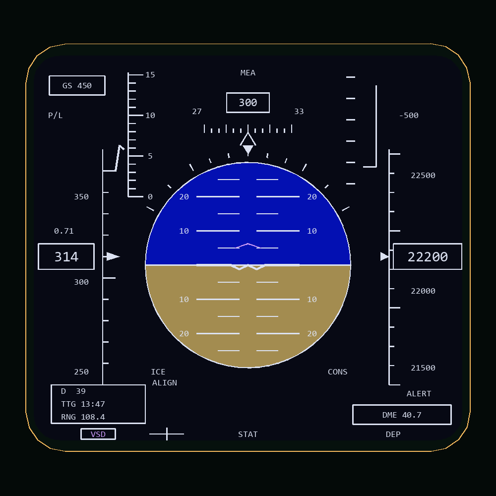

# Left MFD: colour VSD design

The editable **Left MFD** page in Layout Studio is now a basic vertical situation
display, drawn from PDF page 33 (printed 4-20), Figure 4-13, **Basic Display**.
The supplied Figure 4-2 illustration gives the same overall instrument arrangement;
the supplied cockpit photograph establishes the blue/brown presentation.

The final colour choices are Fraser's values: sky **#0310B2**, ground **#A38C50**.
Pale white markings sit over a dark navy background. Muted violet is used for the
VSD selection and a flight-director design cue; that accent is an interpretation
of the photograph, not a colour specification from the monochrome manual.

The page fits the previously measured left aperture of approximately
104.1 x 95.3 mm. It has an inset rounded drawing region, a circular attitude ball,
bank marks and fixed aircraft symbol; heading/AOA/VVI across the upper region;
airspeed and altitude at the sides; and the basic VSD status/data strip below.
The 5 degree pitch ladder increments are a preview mapping, not a calibrated
implementation of the aircraft's attitude display projection.

## Preview and edit

Launch `tools/launch_layout_editor.bat`, choose **Left MFD**, and reset the view.
The source pane edits `Cockpit/Scripts/MFD/Indicator/Left/Left_vsd_page.lua`.
The colour palette and font sizes are in the adjacent `Left_display_def.lua`.
The old `Left_indication_page.lua` alignment starter is preserved separately.

The attitude ball uses `PITCH_HUD` and `ROLL_HUD` (radians); heading, CAS, GS,
Mach and altitude use existing HUD parameters in game and in the offline preview.
Altitude follows the existing HUD altitude-mode parameter.
Those parameter bindings let the design be checked at different attitudes and
readout widths. Heading/speed/altitude tape numbers, AOA and VVI pointer positions,
the director cue, destination 39, TTG, range, DME and status legends are reference
artwork. They are **not valid navigation, guidance or advisory indications**.
The illustrated `ICE`, `ALIGN`, `CONS` and `ALERT` labels are not live warnings.

**Registered as the default in-game left display** through `Left_init.lua` and
`device_init.lua`, on the calibrated `MFD-PLASHKA-CENTER1 / DOWN1 / RIGHT1`
connector frame. Reload the aircraft/mission to load it. The left calibration
overlay is disabled in `Calibration/config.lua`; the HUD and centre
calibration overlays remain enabled. The right HSD is now registered too. Disabling calibration globally
leaves the VSD active.

No OSB actions, ILS/ARS modes, live scrolling tapes, navigation calculations or
operational warning logic have been added. See [the right HSD notes](right-hsd-design.md) for the companion display.

Reference PNGs use approximate desktop font metrics; confirm physical font sizes
and line widths in game after reloading the aircraft. Depth testing
is enabled on the design primitives so cockpit objects can occlude them.

Validation: Lua execution, colour values, changing flight readouts, attitude
controller support, main-power gating, source dragging and visual PNG review.
