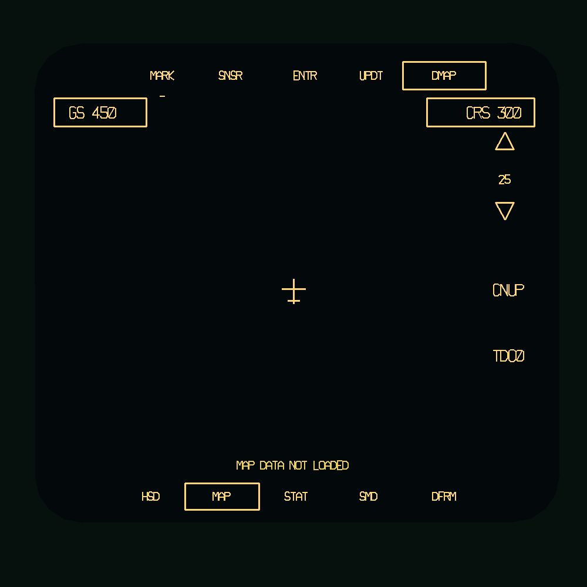
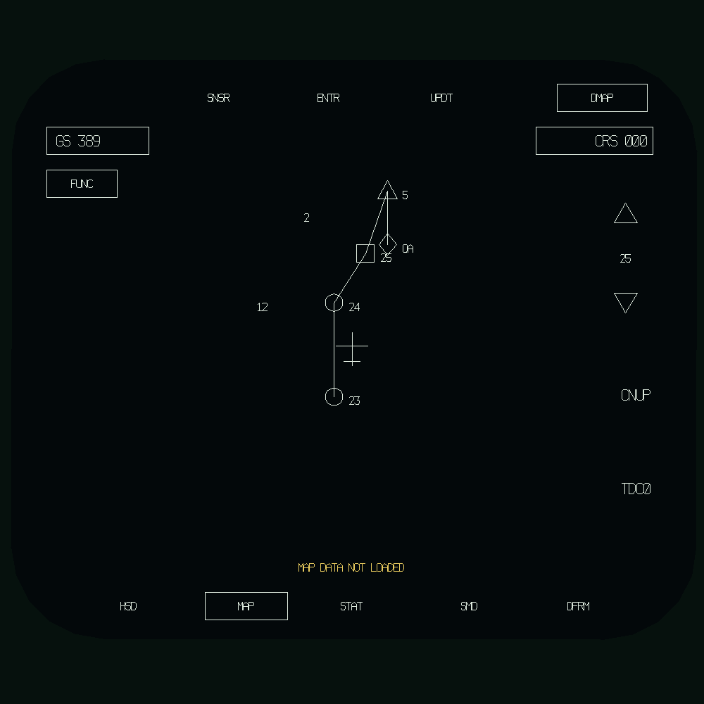

# OCIP cockpit and Harris moving-map research

Research reviewed 30 October 2026. This mod targets the later cockpit arrangement;
individual sources describe different dates and upgrade standards.

## Simulator configuration update, 2 November 2026

The user-specified OCIP III configuration supersedes the earlier working layout
below: left colour VSD, centre green IRADS, right colour digital moving map.
Left alternatives are grayscale IRADS, MAP and HSD; right alternatives are HSD
and VSD. IRADS controls select only wide/narrow endpoint presets. This is the
simulator configuration requested for this project; the earlier source assessment
below is retained as research history, including its disagreements about layout.

## Findings and source assessment

| Source | Finding used | Limits |
| --- | --- | --- |
| [TO 1F-117A-1A, February 1992 OCIP supplement](https://studylib.net/doc/28008143/lockheed-f-117a-nighthawk-utility-flight-manual-text), printed pp. 4-12–16 | Left CMDI EO selection; map modes, ranges and symbology | Public OCR mirror of a primary manual. Its map section describes CMDI functions, not proof of an identical central Harris format. Check scanned figures for exact placement. |
| [F-117 Stealth Fighter Association](https://www.f117sfa.org/about-the-f117) | Upgraded equipment includes HUD, twin colour multifunction indicators, digital moving map and RLG/GPS navigation | Operator-community source; overview does not assign every format to a physical screen. |
| [F-117A.com, Upgrades I / OCIP II](https://www.f-117a.com/Upgrades1.html) | Explicitly places Harris moving map in the former central FLIR/DLIR position and moves IR imagery to a side colour display | Secondary account; cockpit illustration attributed to Lockheed Martin Skunk Works. Page text was available in search, but direct fetch returned 502 during review. |
| [Aviamagazine, Upgrades](https://www.aviamagazine.com/reference/aircraft/f117/index.aspx) | Independently describes central FLIR-display replacement, colour side displays, FMS and PAARS | Secondary history. Reports first modification test in aircraft 831 on 1 December 1988 and fleet installation April 1990–March 1995. |
| [Roadrunners Internationale](https://roadrunnersinternationale.com/haveblue.html) | Describes Honeywell colour display / Harris moving-map integration and LCD data entry | Wording also mentions CRT multifunction displays. Do not merge those hardware descriptions into a single dated fit without further evidence. |
| [Aus Air Power / Carlo Kopp](https://www.ausairpower.net/Profile-F-117A.html) | Reports Honeywell colour MFD / Harris tactical-map integration | Originated December 1990, with later editorial corrections. Its HUD/helmet FLIR projection discussion is explicitly conjectural. |
| [MiGFlug](https://migflug.com/aircraft/f-117-nighthawk/) | General corroboration of map and OCIP upgrades | Secondary overview, not evidence for exact display placement, controls or delivery logic. |
| [1992 baseline Utility Flight Manual](https://pdfcoffee.com/1992-to-1f-117a-1-utility-flight-manual-usaf-series-f-117a-aircraft-3-pdf-free.html) | Earlier sensor-display and backup-video descriptions provide context | Public OCR is poor. Baseline and supplement must be read together; generic sensor-display terminology does not disprove later hardware replacement. |

The earlier working arrangement was centre moving map, left CMDI selectable EO/flight
formats, right CMDI flight/navigation/system formats, and HUD flight/attack
symbology. Defaulting the left CMDI to EO was an earlier mod preference,
not a verified real-aircraft power-up selection. HUD infrared video has not been
established by this research.

The supplement specifies 10/25/50/100/140 NM range choices (25 default), centered
or decentered north-up/track-up orientations, automatic and manual LOOK/SCROLL
operation, paper/digital databases, route/threat overlays and terrain highlighting.
Decentered ownship is 75 percent down the map. These are functional references
for the outline, not a claim of exact Harris central-display artwork.

Unsupported earlier statements must not become requirements: a literal IRADS
HANDOVER legend, an exact automatic handover trigger, single/fixed DLIR FOV,
fixed laser timing before release, and seamless HUD video handover. The pasted
laser accounts contradict one another about release versus impact. Field of view
and turret field of regard are different quantities. DCS camera-hook/debugging
notes describe the simulator implementation, not historical aircraft behaviour.

## Implemented map presentation

The user supplied three manual captures on 30 October 2026: **MAP SYMBOLOGY**
(23:01:37) and **MAP DISPLAY** (23:01:53 and 23:02:26). These establish the
route glyphs, labelled map controls, aircraft reference, IRADS cursor and
paper/digital/manual/function-page arrangements. They are stronger evidence
than a Hornet comparison. The CMDI format is adapted to the mod's measured
central aperture; this does not prove an identical dedicated Harris screen
or physical bezel assignment. Colours, font metrics and exact sizes remain
implementation choices.

- Left CMDI starts in EO. Ctrl+Shift+E toggles EO/VSD; sensor power is independent.
- The map uses PMAP/DMAP selection, GS, ground **course** (CRS, not heading),
  range arrows, orientation, function-page and tactical-declutter legends.
  The previous decorative reference grid has been removed.
- Ownship uses the illustrated aircraft reference, with a separate open-centre
  IRADS cursor at the existing valid designated ground point. No target
  designation is converted into a route waypoint automatically.
- Ranges remain 10, 25, 50, 100 and 140 NM, initially 25. Orientation cycles
  CNUP, CTUP, DNUP, DTUP; CNUP startup remains a mod choice. Track-up uses
  ground velocity, falling back to heading below 5 m/s. Decentered ownship
  is 75 percent down the 106 mm map window.
- Up to 64 planned waypoints and connecting legs, plus 32 stored threat
  locations, are supported. Route legs clip independently of endpoint
  visibility. Invalid records break the route rather than joining across a gap.
- Waypoints: navigation/takeoff/ingress circle; target triangle; offset aimpoint
  diamond; initial point square; air-refuelling contact point horizontal oval.
  Symbols are hollow and retain an adjacent plan label.
- Threat codes follow the supplied legend: Q, TR, HF, GC, C, R, H, A, E;
  2, 3, 4, 5, 6, 8, 10, 11, 12; N1, N3, N4, N6, N7. Unknown codes are hidden.
  These are supplied planning locations, not a live sensor or omniscient feed.
- LOOK/SCRL hold the map's world centre and expose a central map cursor.
  Pan actions move the centre in screen directions, five percent of map height
  per press. AUTO resumes aircraft following. LOOK and SCRL currently share
  this basic panning model; their full distinct real-aircraft cursor/slew
  behaviour has not been reconstructed from these figures alone.
- Tactical declutter cycles all overlays, route only, then neither route nor
  threats. This grouping is a mod choice, not a verified real TDC sequence.
- Function 1 exposes background declutter, reference-elevation mode and an
  adjustable elevation value. Those settings are retained, but cannot affect
  Harris elevation shading. PMAP/DMAP select the requested database type; both
  currently share the common DCS chart underlay. `MAP DATA NOT LOADED` stays
  visible until the experimental chart camera becomes ready.
- SNSR, ENTR, UPDT, HSD, STAT, SMD and DFRM are reference legends only; their
  underlying pages/update procedures are not implemented. No ALERT or COR
  condition is invented. New controls are input actions, not a claim that
  the illustrated bezel buttons have been connected to the central EDM.
- Scale currently spans the full 106 mm map height. Exact Harris range
  semantics remain unverified. Positions are DCS sensor coordinates, not a
  newly simulated INS solution. No Harris terrain shading, automatic avoidance or INS map correction is
  supplied. The generic DCS chart backend can now request theatre chart imagery;
  see the implementation follow-up below for its experimental status.

### Controls

All actions are under **F-117A Displays**, and are bindable on joystick profiles.

| Keys | Action |
|---|---|
| Ctrl+Shift+[ / ] | Decrease/increase range |
| Ctrl+Shift+M | Cycle orientation |
| Ctrl+Alt+Shift+M | PMAP/DMAP |
| Ctrl+Alt+Shift+F | Function page |
| Ctrl+Alt+Shift+L / S / A | LOOK / SCRL / AUTO |
| Ctrl+Alt+Shift+arrows | Pan in manual mode |
| Ctrl+Alt+Shift+D | Tactical declutter |
| Ctrl+Alt+Shift+B | Background declutter setting |
| Ctrl+Alt+Shift+R | Reference elevation mode |
| Ctrl+Alt+Shift+PgUp / PgDown | Elevation selection, 1,000-foot steps |

### Planning data

`Cockpit/Scripts/Systems/MapMission.lua` returns `{route={}, threats={}}` by
initial default. Supply explicit DCS world coordinates in metres (`x` north,
`z` east), not latitude/longitude or mission-file `y` without conversion:

```lua
return {
    route={
        {x=100000,z=200000,kind="navigation",label="23"},
        {x=110000,z=202000,kind="initial",label="24"},
        {x=120000,z=205000,kind="target",label="5"},
    },
    threats={{x=115000,z=210000,code="6"}},
}
```

These coordinates are an example schema, not a furnished route for any theatre.
The map factory also accepts a plan table as its second argument for a future
mission integration. No automatic mission-editor route importer exists yet;
editing this local plan currently requires a mission reload. The default
therefore draws no route or threat symbols.





The second preview exercises the geometry with invented test points only;
those points are not shipped in the default plan. Layout Studio exposes
**Central Map** for editing. **MFD** remains the shared IRADS symbol template.
**Left MFD** previews EO by default; use `F117_LEFT_EO=0` for the VSD.

## Rendering and brightness integration

The proven camera source still registers target 0 / `render_target_1`. Its
original centre-mounted surface remains underneath the map's opaque background;
left EO samples that target's texture, `mfd0`. This retains the existing EFM camera bridge and
avoids another camera, bake or unverified render-source relocation. The central
map does not contain targeting symbology and does not depend on sensor power.

The central map deliberately retains legacy marker `F117_IRADS_SOURCE` for the
installed native brightness/compositor ABI. It now uses `1-CDBrightness` as its
native gain and `F117_MAP_DIM_OPACITY` on fallback. No native rebuild is needed.
The optional compositor remains disabled (see `display-readability.md`); future
source relocation should remove the hidden centre video surface only after
validating the EFM camera discovery.

Left EO uses the lower of left-display luminance and IRADS image brightness;
VSD uses left luminance alone. Contrast remains the IRADS setting. This preserves
night dimming and makes the existing IRADS brightness controls affect targeting
without dimming the map. Fallback EO opacity uses `F117_LEFT_EO_DIM_OPACITY`.

## Verification and remaining work

Offline checks cover startup selection, range limits, orientation/target math,
invalid/offscreen data, sensor-state isolation, central page routing, opaque
background, native userdata property access, brightness handover and layout
editing. A rendered preview was inspected. Checks also cover all waypoint kinds, invalid records,
route-window clipping, declutter, manual panning and return to AUTO. Geographic
map ingestion, automatic mission-plan import and terrain elevation shading remain
future functionality.

## Harris terminology and patent follow-up

The user's DMMS (digital moving-map system) / DMG (digital map generator) leads
are recorded here as research terminology. A map generator is the processing
part of a mapping system; these links do not establish a particular F-117 box
part number or prove DMMS was the official installed product name. Continue to
label the mod's page Harris digital moving-map outline until that is established.

- [US6011875A](https://patents.google.com/patent/US6011875A/en) concerns
  Gram–Schmidt pan-sharpening of multispectral imagery. Filed by Eastman Kodak
  in 1998, its record lists a later 2016 assignment to Harris. It is not evidence
  for the 1988 OCIP map architecture or F-117 display format. A current Harris
  assignee label alone must not be taken as proof of that connection.
- [US4520506A, user-supplied PatentCue link](https://patentcue.com/patents/US4520506A/)
  is identified in the citation table of US4970682A as Harris's method/system for
  compression and reconstruction of cultural data in a digital moving-map
  display, published 28 May 1985. The PatentCue and Google full-text pages were
  inaccessible during review; only bibliographic identity was verified through
  the related patent. No unseen algorithm details were used.
- [US4970682A, Digital map generator and display system](https://patents.google.com/patent/US4970682A/en)
  is a relevant Harris architectural source. It describes compressed elevation
  and cultural data, buffering/reconstruction, scene memory positioned by a
  navigation computer, and rotated readout for heading-up presentation. Its
  selectable processing includes terrain shading, contour and cultural layers.
  This supports separating map data, navigation transforms and presentation in
  a future implementation. It does not establish F-117 installation, the exact
  central-page appearance, or that every patented option was fielded.

A future geographic backend should therefore provide bounded georeferenced data
loading/cache, elevation/cultural layers, navigation-centered rotation, and
separate route/threat/IRADS overlays. Our current page implements presentation
and ownship/IRADS/planning transforms; it is not a compressed map database or
a reconstruction of the Harris processor.

## STARS terrain data and storage-medium follow-up

Additional user references: [Upgrades I](http://www.f-117a.com/Upgrades1.html)
and [Upgrades II](http://www.f-117a.com/Upgrades2.html). Direct retrieval again
failed (502/timeout), although indexed text was available. Upgrades I's indexed
OCIP II account supports replacement of the central FLIR/DLIR display with the
Harris moving map. These pages were not used to claim verification of the exact
STARS storage medium.

A contemporary **Harris manufacturer advertisement** in
[Army Aviation, December 1985](https://armyaviationmagazine.com/images/archive/backissues/1985/85_12.pdf)
identifies STARS as terrain-data mapping technology using Defense Mapping Agency
data, with selectable features and map movement tied to aircraft motion. The
advert describes cassette storage for its advertised system and mentions other
prospective aircraft; it does not identify an F-117 installation. It establishes
Harris STARS as a real technology name, not the exact F-117 configuration.

The F-117-specific account in *Modern Fighter Aircraft Technology and Tactics*,
printed p. 163 ([public scan](https://www.imagery.vnfawing.com/PDF-Archive/Modern-Fighter-Aircraft-Technology-and-Tactics_web.pdf)),
reports Harris STARS terrain data stored on magnetic disc and map presentation
on the new colour MFDs. Record **magnetic-disc storage as a secondary-source
report**, distinct from the generic cassette architecture in Harris patents and
advertising. Storage hardware could vary by installation or date; no exact drive,
capacity, file format, loading procedure or failure behaviour has been verified.

The central page remains a Harris moving-map approximation. Its geographic
backend should be described as a simulation of stored terrain/cultural data,
with STARS retained as researched technology context. It currently neither loads
STARS data nor emulates a magnetic-disc drive. Do not substitute a live radar
picture or satellite feed for the stored-map function.


## Installed Hornet implementation follow-up

The local FA-18C scripts identify an ASQ-196 native DMC and demonstrate map
video sampled through a render-target texture, with independent outlined
symbology. They also explicitly couple map-camera decentering to the display's
navigation state. See [native map-rendering investigation](native-map-rendering.md)
for source paths, the implemented texture adapter and shared view
contract. A generic DCS theatre-chart producer has since been implemented, using the
common avKneeboard/ccKneeboard path rather than either aircraft-specific DMC. It does
not load Harris STARS data or supply Harris-specific elevation shading.
