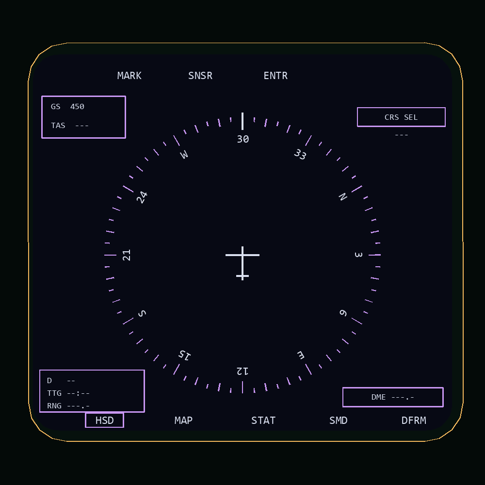

# Right MFD: basic HSD

Based on PDF page 36, printed 4-23, Figure 4-14, Basic HSD, and the supplied
screenshot. Colours interpret the earlier cockpit photograph: dark navy with
pale violet compass ticks and boxes, and pale white text and aircraft symbol.

The heading-up card has five-degree graduations, numeric thirty-degree marks,
cardinal letters, a fixed lubber line and fixed aircraft symbol. Heading and
GS use existing `HEADING_HUD` (degrees, existing true/magnetic selection) and
`GS_HUD` (knots). The card rotates with heading; it does not move with pitch or bank.
TAS, course preselect, destination, TTG, range and DME show dashes because those
sources have not been connected. There are no invented warning, master-arm,
course, drift, destination or TACAN pointers. The optional presentation in the
lower illustration on page 36 is not implemented. Switch legends are visual;
OSB actions and navigation calculations are not added by this page.

Registered as the default right display in `device_init.lua`, through
`MFD/Indicator/Right/Right_init.lua`, using the calibrated
`RADAR-PLASHKA-CENTER / DOWN / RIGHT` connector frame. Right calibration is
disabled in `Calibration/config.lua` to prevent overlap. The historical RADAR
anchor name identifies the screen location. Depth testing is enabled, and the
rounded safe area fits the measured 104.1 x 95.3 mm aperture.

Reload the aircraft/mission to load the page. Use Layout Studio -> Right MFD to
edit `Right_hsd_page.lua`. Palette and fonts are in `Right_display_def.lua`.
The old `Right_indication_page.lua` alignment starter is preserved separately.
The amber outline in the preview is an editor guide and is not drawn in DCS.

Offline checks cover independent init/page environments, Lua syntax, registration
with calibration enabled/disabled, depth flags, power gating, card orientation at
four cardinal headings, changing GS, source editing and PNG review. DCS font
metrics and physical rendering still require in-game verification.
